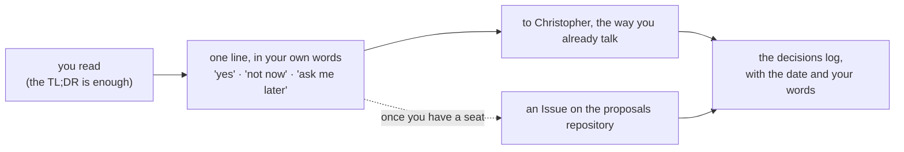
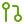

# Start here

### The reading room in five lines: what is here, in what order, and how to bring your helper along

*Read this one once. Everything else in the room assumes you have.*

---

##  TL;DR

> [!TIP]
> **Five lines, if that's all you read.**
>
> 1.  **This room is a brother's gift.** Everything in it was written for the business and asks nothing of it. *"Not now"* is a complete answer, and so is silence.
> 2.  **Read in this order:** [Opening your gift](../OPENING-YOUR-GIFT.md) first; then, when curious, [The words of web3](../web3/the-words-of-web3.md); the [procedures](../procedures/README.md) and [proposals](../proposals/README.md) whenever a question comes up.
> 3.  **Bring your helper.** Claude, ChatGPT or any assistant can read these pages with you, never more than you can (below).
> 4.  **Nothing here is advice,** and nothing here touches the business's bank, prices or customers. The web3 pages explain words; they never say what to buy, hold or sell.
> 5.  **Nothing is published by being here.** A page reaches the public room only after an owner lists it and a check has read it.

---

##  The room, in order

| | Read | When | Why |
|---|---|---|---|
|  | [Opening your gift](../OPENING-YOUR-GIFT.md) | first, five minutes | what has been given, what to expect, the first ten minutes, what it could become |
|  | [The words of web3](../web3/the-words-of-web3.md) | when curious | the words, each in one plain sentence; the handful of things never to type into a website |
|  | [Before you connect a wallet](../web3/before-you-connect-a-wallet.md) | before any wallet, ever | a readiness check: if any line is a no, the answer is "not yet" |
|  | [Procedures](../procedures/README.md) | when a "how does this work?" comes up | how a change travels, who says yes, what may go public, the first hour on GitHub |
|  | [Proposals](../proposals/README.md) | when one is offered | an idea, with a TL;DR, a decisions log, and no ask |

---

##  Bring your helper (three steps)

> [!IMPORTANT]
> **Your AI helper can read these pages with you.** Any assistant that can read a PDF or connect to GitHub can summarise
> a page, explain a word, and help you answer in your own words.
>
> 1. **Give it the page.** The simplest way: hand it the `.md` file, or the PDF *and* the `.md` beside it. Once you have your
>    seat, a helper can also be connected to GitHub with read-only access to this room only
>    ([SOP-IT-002](../procedures/IT/SOP-IT-002-reading-room-and-helper-access.md)).
> 2. **Paste a first message:** *"Read Start here in the reading room, then tell me in five lines what is in it and
>    whether anything is waiting on me. Don't change anything."*
> 3. **Ask in your own words.** A helper never needs a password, a sign-in code, a bank login or a seed phrase, and never gets one.

---

##  How to answer, if you ever want to

---

##  Five GitHub words, and no more

| Word | Plain meaning |
|---|---|
|  **Repository** | a folder with a memory: every change to every file, with who made it and when |
|  **Branch** | one line of that history; `main` is the copy everyone treats as real |
|  **Pull request** | *"please look at this change and, if you agree, make it the real one"*; a person says yes |
|  **Issue** | a numbered conversation attached to a repository; the simplest way to ask or answer |
|  **Merge** | accepting a pull request, so the change lands; a person does it, never a helper |

That is all a reader needs. [SOP-COM-001](../procedures/COM/SOP-COM-001-new-to-github-your-first-hour.md) is the first
hour on GitHub, whenever it is wanted.

---

Wilson's Lawn Maintenance on GitHub · kept by the drasticstatic lab, a brother's gift · Icons: Lucide (ISC).

