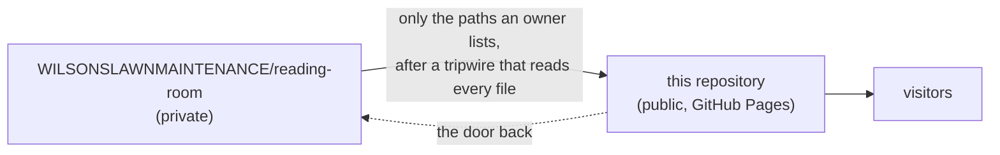

# Wilson's Lawn Maintenance · the reading room, for visitors

*What the business has chosen to share: how its pages are read, and the procedures it keeps.*

**Read it at [WILSONSLAWNMAINTENANCE.github.io/reading-room-public](https://WILSONSLAWNMAINTENANCE.github.io/reading-room-public/).**
The front page links the welcome decks, the business's Facebook page, every page that has been shared here, and the
door to the members' room.

## The members' room

Everything written for the business is read first in a private room,
[`WILSONSLAWNMAINTENANCE/reading-room`](https://github.com/WILSONSLAWNMAINTENANCE/reading-room), by the business's owners
and the readers they name. That link shows a 404 to anyone signed out or not yet invited: it means "not yet", not
"broken". Access is the business's to give; ask Christopher, who keeps these pages, and give only your GitHub username.
Nobody here will ever ask for a password, a code or a key.

## How this room works

When an owner decides a page is ready for visitors, they add it to the private room's list of pages to share, and an
automatic copy brings it here. The copy reads every file before it leaves (the words inside PDFs too; no keys, no agent
notes, nothing a machine or a person has not read) and records what it brought in `room-manifest.json`, which the front
page reads to list them.

| This repository holds | Written by |
| --- | --- |
| `index.html`, this `README.md`, `.nojekyll`, `banner/`, `assets/icons/`, `LICENSE`, `LICENSE-CONTENT` | by hand, by pull request |
| every other page, and `room-manifest.json` | the automatic copy only; never edited here |

The front page is plain HTML with no build step: it works on a phone, follows your light or dark setting, and is served
by GitHub Pages from `main`. `main` carries a deletion-only rule, because the automatic copy writes to it.

Wilson's Lawn Maintenance on GitHub · [profile](https://github.com/WILSONSLAWNMAINTENANCE) · code MIT, words CC BY-SA 4.0; the business's name and marks belong to the business. Kept by the drasticstatic lab, a brother's gift.
