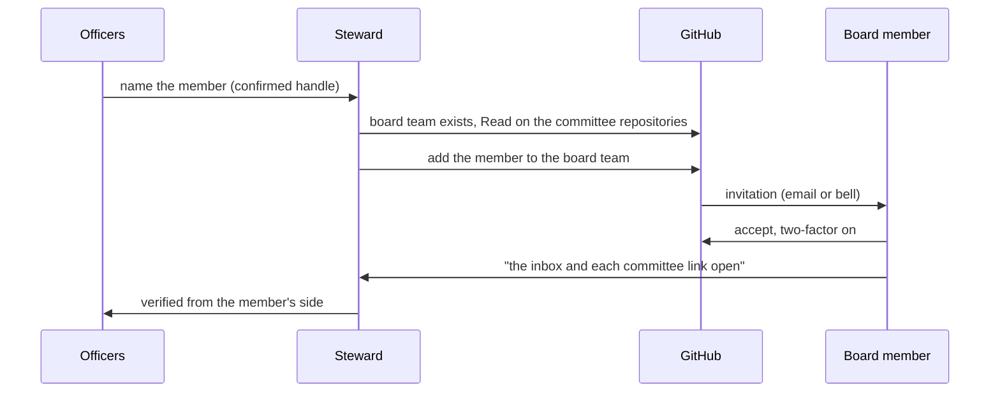

# SOP-GOV-001 · Board reading room membership

**Department:** GOV · **ID:** 001 · **Status:** draft (approved when tagged) · **Owner:** the business's owner; the steward (Christopher, or a helper preparing commands for him) executes · **Last changed:** 2026-10-31

> **Filled in for Wilson's Lawn Maintenance (2026-11-04).** A one-owner business has no board of directors, so the
> words below read: the *Board* is the owner and the people he names; `readers` is the closed team; the one repository it
> reads is `reading-room`; the inbox is that room's README; the owner names the readers. The worked example at the end is
> PIR's first run, kept as the template keeps it.

##  Purpose
How a member of `WILSONSLAWNMAINTENANCE`'s board of directors is given **Read** on `reading-room` through a closed GitHub team, how they accept, and how the steward verifies it from the member's side.

##  Scope
`WILSONSLAWNMAINTENANCE`, for every board member and every committee repository the Board should read. **GitHub membership is not Board membership:** `the owner` decide who sits on the Board; this procedure only opens the door for the people they name. Write access, treasury and credentials are out of scope.

##  Roles
| Role | Does |
|---|---|
| `the owner` | name the Board members, by confirmed GitHub handle |
| Steward (an organisation owner, or a helper preparing commands for one) | creates `readers` once, grants Read, adds members, verifies |
| Member | accepts, reads, reports a link that does not open |

##  Prerequisites
The committee repositories exist under `WILSONSLAWNMAINTENANCE` (not under a personal account: a personal private repository cannot give anyone read-only access, SOP-IT-002). The steward is an owner of `WILSONSLAWNMAINTENANCE`, or holds the commands for one.

##  Who does what, in order



With the organisation's base permission at **No permission** (SOP-GOV-002), this team is the only way a member reads the committee repositories, so the team page is the true list of who can.

##  Steps: steward
1. Create the closed team once. *You should see:* the team page; `repos_count 0`, `members_count 1` at creation is normal (the creator).
   ```sh
   gh api -X POST orgs/WILSONSLAWNMAINTENANCE/teams -f name=readers -f privacy=closed
   ```
2. Grant Read on each committee repository.
   ```sh
   for r in reading-room; do gh api -X PUT orgs/WILSONSLAWNMAINTENANCE/teams/readers/repos/WILSONSLAWNMAINTENANCE/$r -f permission=pull; done
   ```
   *You should see:* `gh api orgs/WILSONSLAWNMAINTENANCE/teams/readers/repos --jq '.[].name'` lists each one.
3. Add each Board member by their confirmed handle, on an officer's yes.
   ```sh
   gh api -X PUT orgs/WILSONSLAWNMAINTENANCE/teams/readers/memberships/<login>
   ```
   *You should see:* `state: pending` until they accept, then `active`.
4. Verify as a member would: ask one member to open `the reading room's README (`WILSONSLAWNMAINTENANCE/reading-room`)` and one link per committee from their own account. An owner's successful read proves nothing about a member's access.

5. **Every new repository joins the board's list.** A team sees only the repositories someone added to it, one by one; once the base permission is *No permission*, a repository created next month is invisible to the board until it is added. So, right after creating any private repository, and once a month:
   ```sh
   sh scripts/board-sees-everything.sh WILSONSLAWNMAINTENANCE readers          # lists what the board cannot read (read-only)
   sh scripts/board-sees-everything.sh WILSONSLAWNMAINTENANCE readers --apply  # grants Read on each one
   ```
   *You should see:* `WILSONSLAWNMAINTENANCE/readers reads all N private repositories.` The script never adds or removes people.

##  Steps: member
1. Give the steward your GitHub handle privately.
2. Turn on two-factor authentication **first**, with a passkey or an authenticator app (not text messages): GitHub will not add an account without it to a team in an organisation that requires it ([SECURE-TWO-FACTOR.md](https://github.com/drasticstatic/my-template/blob/main/walkthroughs/SECURE-TWO-FACTOR.md)). Then accept the organisation invitation (email, or the bell icon on GitHub).
3. Accept the team assignment if GitHub asks.
4. Open `the reading room's README (`WILSONSLAWNMAINTENANCE/reading-room`)` and one link from each committee; if one does not open, report the address and the error, never a credential.
5. Read in the browser. Bringing an AI helper is a separate request (SOP-IT-002).

##  Verification
`gh api --paginate orgs/WILSONSLAWNMAINTENANCE/teams/readers/members --jq '.[].login'` lists every named Board member; `gh api orgs/WILSONSLAWNMAINTENANCE/teams/readers/invitations` is empty; each member has opened a committee link from their own account.

##  Troubleshooting
| Symptom | Likely cause | What to do |
|---|---|---|
| Inbox links open for the owner but not for members | repositories not attached to the team, or members still pending | steps 2–3; wait for acceptance |
| A member sees more than Read | another team, or the organisation's base permission, grants it | inspect inherited roles under the organisation's settings; set the base permission to *No permission* (SOP-GOV-002 says why and how) |
| A repository is missing from the team | it was created after step 2 (teams do not pick up new repositories by themselves) | step 5: `sh scripts/board-sees-everything.sh WILSONSLAWNMAINTENANCE readers --apply` |
| A member left the Board | the officers said so | `gh api -X DELETE orgs/WILSONSLAWNMAINTENANCE/teams/readers/memberships/<login>`; their organisation membership is a separate decision |

##  Worked example: Psychedelics in Recovery® (live state, read 2026-10-30)

> This is PIR's first run, kept as the example. It is **not** a template default; other organisations fill in their own.

- `WILSONSLAWNMAINTENANCE` = `psychedelicsinrecovery`, `readers` = `board`, `reading-room` = `tech-committee public-relations literature-committee`, `the reading room's README (`WILSONSLAWNMAINTENANCE/reading-room`)` = the `board` repository's README.
- Read on 2026-10-30: the three committee repositories at Read on the `board` team, one active member, no pending invitations.
- The access guide's PIR insert (`my-template/org-onboarding/ACCESS-AND-PATS.md`) and the PIR desk proposal 002 *The Board reading room* are the background.

##  Related
- SOP-IT-002 (reading room and helper access; the generic reading-room route), SOP-GOV-002 (teams and base permission)
- `my-template/org-onboarding/ACCESS-AND-PATS.md`
- Proposal: PIR desk 002 *The Board reading room* (the first organisation to run this)

##  Change log
| Date | Change | By |
|---|---|---|
| 2026-10-30 | Drafted; PIR grants verified by read the same day (three repositories at Read, one member, no pending invitations) | Alfred |
| 2026-10-31 | Generalised for every organisation's board: placeholders, a fill-in box, PIR's live state moved to a marked worked example; member removal added | Alfred |
| 2026-11-01 | Lucid pass: Lucide icons, the order of hands in Mermaid; base permission none (SOP-GOV-002) makes the board team the true list | Alfred |
| 2026-11-01 | Step 5: every new repository joins the board's list (`scripts/board-sees-everything.sh`, read-only unless `--apply`); two-factor first for members (GitHub refuses a team add without it) | Alfred |
